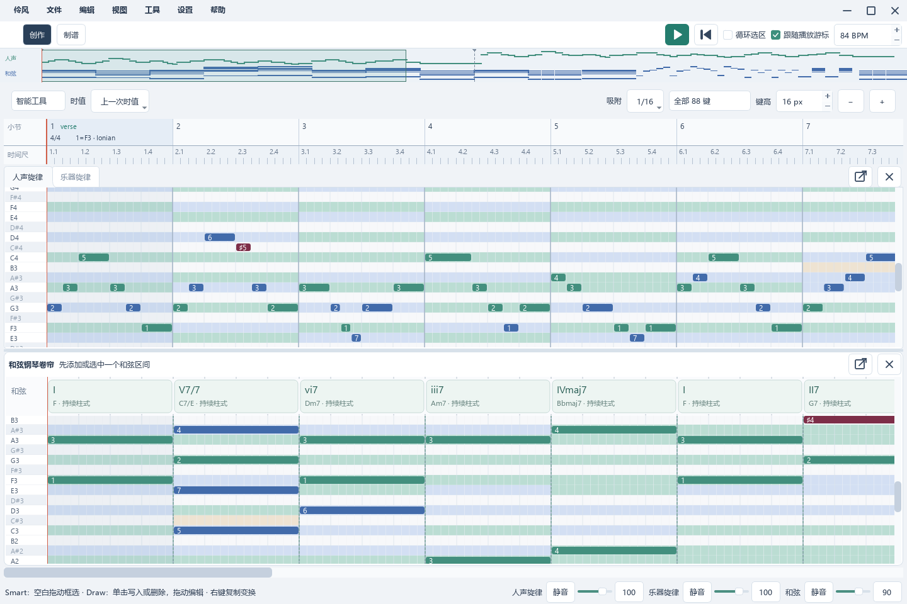
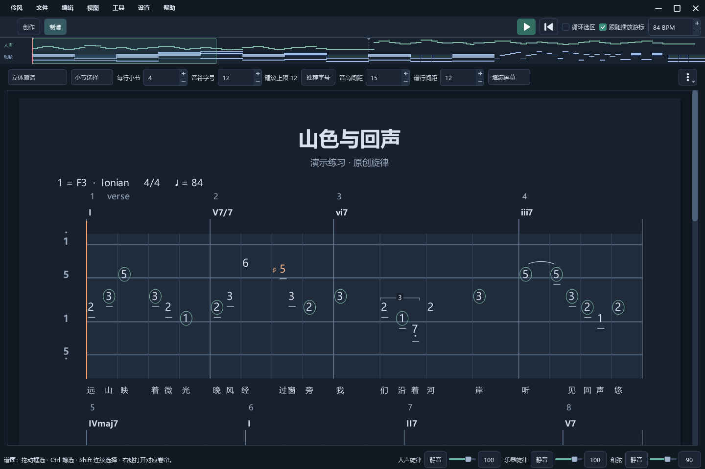
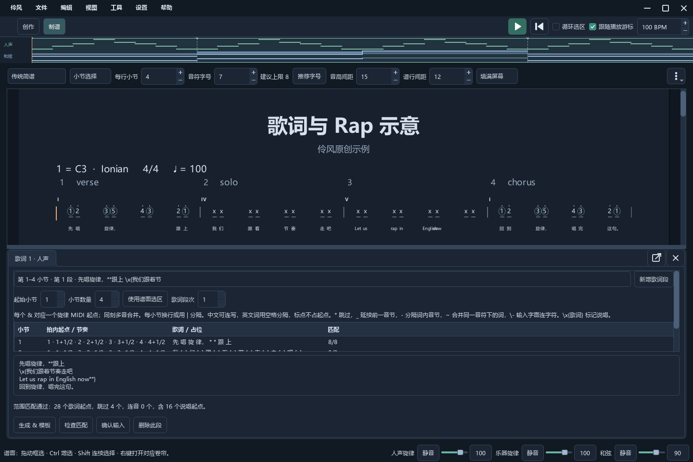
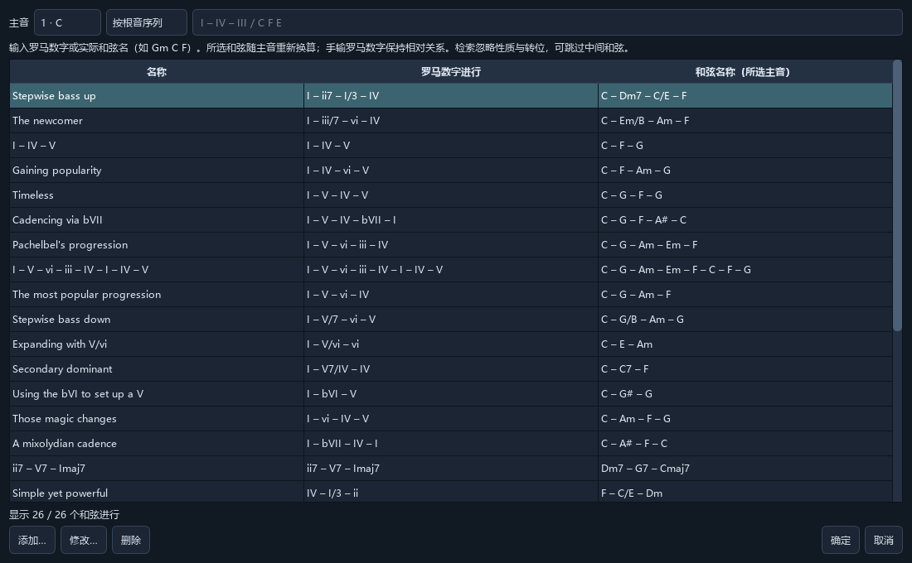

# 伶风 Lingfeng

**为流行音乐而生 · For Pop Music**

面向 Windows 的轻量音乐创作与简谱制谱软件，用于编写旋律、和弦、伴奏与歌词。

A lightweight Windows app for songwriting and jianpu, with melody, chords, accompaniment and lyrics.

**0.57 · Windows x64 · 便携免安装 / Portable**

[下载 / Download](https://github.com/li-Ko-Ko/Lingfeng/releases/latest) · [操作帮助 / User guide](docs/HELP.md) · [问题反馈 / Issues](https://github.com/li-Ko-Ko/Lingfeng/issues)

下载后完整解压，运行 `Lingfeng.exe`，保留同级的 `_internal/` 和 `synths/` 文件夹。

Extract the download completely, then run `Lingfeng.exe`. Keep the `_internal/` and `synths/` folders beside it.

独立程序无需安装 Python，附带免费钢琴、电钢琴及 37 个合成音色，大型钢琴与键盘音源可按需下载。

The standalone application needs no Python installation. Free piano, electric pianos and 37 synth presets are included, with optional piano and keyboard downloads.

## 主要功能 / Features

- 旋律与和弦钢琴卷帘，支持量化、复制、分割合并、撤销及独立悬浮 / Melody and chord piano rolls with quantization, copying, split/join, undo and floating windows.
- 伴奏节奏型与和弦进行库；设置中可全局开关节奏型识别 / Accompaniment patterns and progression library, with a global rhythm-recognition switch.
- 按段落标识跳转小节，导航器显示无文字段落边界 / Jump to marked sections; navigators show section boundaries without text.
- 可保存旋律／和弦默认力度、常用力度及快速和弦性质 / Saved note/chord velocity defaults, velocity presets and quick chord qualities.
- 手动和弦标记同步卷帘高亮及谱面圈音；复制粘贴保留实际配器、时序与力度 / Manual chord labels guide highlights and score circles; copies preserve performed voicing, timing and dynamics.
- 立体／紧凑简谱支持多声部，传统简谱用于单声部；支持歌词、Rap 与连音弧 / Spatial and compact polyphonic jianpu, traditional monophonic jianpu, lyrics, rap and slurs.
- MIDI 导入，PDF、MIDI、MP3 导出；`.lfs` 工程、中英界面及浅深主题 / MIDI import; PDF, MIDI and MP3 export; `.lfs` projects, Chinese/English UI and light/dark themes.

## 精选截图 / Featured

<table>
  <tr>
    <td width="50%"><strong>旋律与和弦编辑 / Piano rolls</strong><br><a href="docs/screenshots/compose.png"></a></td>
    <td width="50%"><strong>立体简谱 / Spatial jianpu</strong><br><a href="docs/screenshots/spatial-score.png"></a></td>
  </tr>
  <tr>
    <td width="50%"><strong>歌词与 Rap / Lyrics and rap</strong><br><a href="docs/screenshots/lyrics-rap.png"></a></td>
    <td width="50%"><strong>和弦进行库 / Chord progressions</strong><br><a href="docs/screenshots/progression-library.png"></a></td>
  </tr>
</table>

## 从源码运行 / Run from source

需要 Windows x64 和 Python 3.13。在仓库根目录使用 PowerShell 执行：

Requires Windows x64 and Python 3.13. Run these PowerShell commands from the repository root:

```powershell
py -3.13 -m venv .venv
.\.venv\Scripts\python.exe -m pip install -r requirements-build.txt
.\.venv\Scripts\python.exe main.py
```

构建、测试及音源重建见 [CONTRIBUTING / Build, test and sound rebuild instructions](CONTRIBUTING.md)。

## 文档 / Documentation

[源码运行与构建 / Build from source](CONTRIBUTING.md) · [工程格式 / Project format](docs/FORMAT.md) · [音源 / Soundbanks](docs/SOUNDBANKS.md) · [发行日志 / Release history](CHANGELOG.md)

个人维护的开源项目，使用 Python 3.13 与 PySide6。原创代码采用 [MIT](LICENSE)；依赖与音源保留[各自许可](docs/THIRD_PARTY.md)。

A personally maintained open-source project built with Python 3.13 and PySide6. Original code is [MIT](LICENSE); dependencies and synth packs retain [their own licenses](docs/THIRD_PARTY.md).
