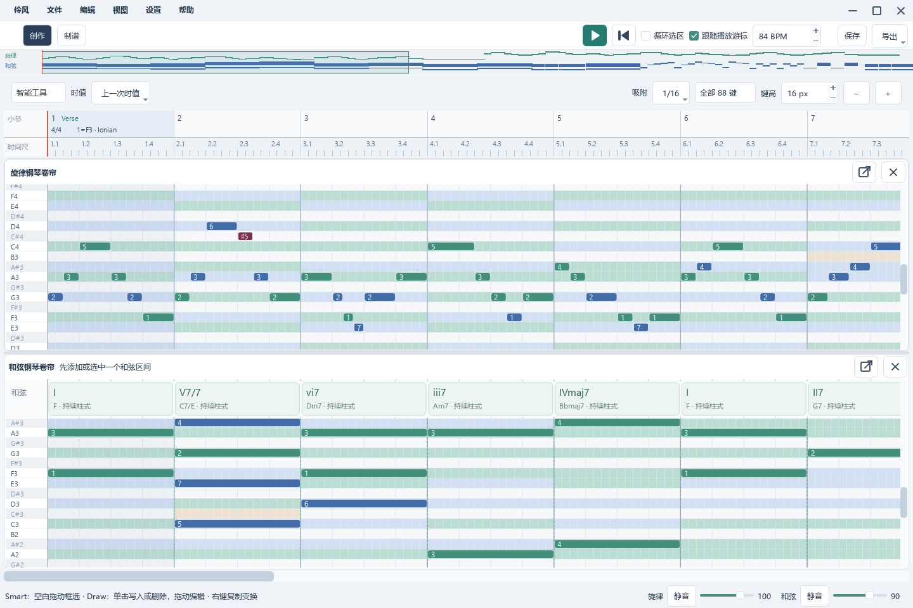
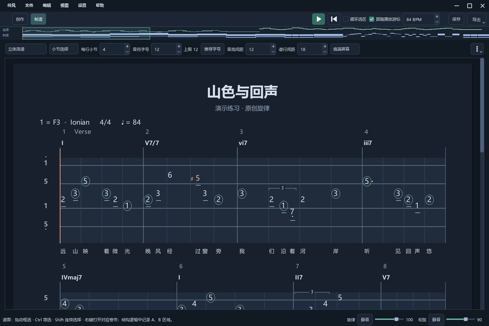
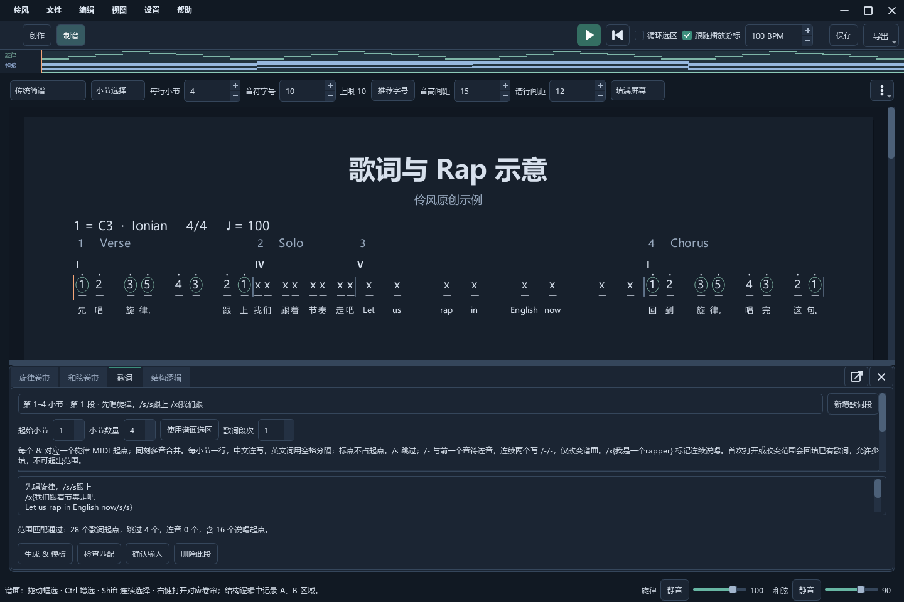
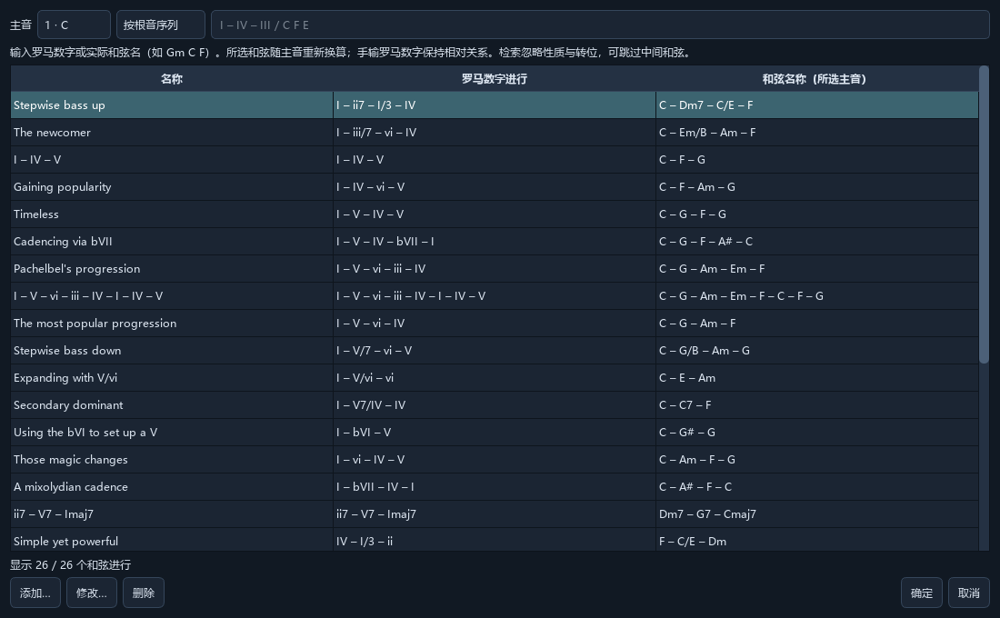

# 伶风 Lingfeng

**为流行音乐而生 · For Pop Music**

面向 Windows 的轻量音乐创作与简谱制谱软件，用于编写旋律、和弦、伴奏与歌词。

A lightweight Windows app for songwriting and jianpu, with melody, chords, accompaniment and lyrics.

**当前版本 0.51 · Windows x64 · 便携免安装 / Portable, no installation required**

[下载最新版本 / Download](https://github.com/li-Ko-Ko/Lingfeng/releases/latest) · [操作帮助 / User guide](docs/HELP.md) · [问题反馈 / Issues](https://github.com/li-Ko-Ko/Lingfeng/issues)

完整解压下载的 ZIP，运行 `Lingfeng.exe`，保留 `_internal/` 和 `synths/`。无需安装 Python，附带三组合成音源、37 个预设。

Extract the full ZIP and run `Lingfeng.exe`, keeping `_internal/` and `synths/`. Python is not required; three synth packs with 37 presets are included.

## 主要功能 / Features

- 旋律与和弦卷帘、伴奏节奏型、和弦进行库 / Piano rolls, accompaniment patterns and chord progressions.
- 传统、立体和紧凑简谱，支持歌词与 Rap 排版 / Traditional, spatial and compact jianpu with lyrics and rap.
- MIDI 导入，PDF、MIDI、MP3 导出；工程保存为 `.lfs` / MIDI import; PDF, MIDI and MP3 export; `.lfs` projects.

## 精选截图 / Featured

<table>
  <tr>
    <td width="50%"><strong>旋律与和弦编辑 / Piano rolls</strong> </td>
    <td width="50%"><strong>立体简谱 / Spatial jianpu</strong> </td>
  </tr>
  <tr>
    <td width="50%"><strong>歌词与 Rap / Lyrics and rap</strong> </td>
    <td width="50%"><strong>和弦进行库 / Chord progressions</strong> </td>
  </tr>
</table>

## 文档 / Documentation

[源码运行与构建 / Build from source](CONTRIBUTING.md) · [工程格式 / Project format](docs/FORMAT.md) · [音源 / Soundbanks](docs/SOUNDBANKS.md) · [更新日志 / Changelog](CHANGELOG.md)

个人维护的开源项目，使用 Python 3.13 与 PySide6。原创代码采用 [MIT](LICENSE)；依赖与音源保留[各自许可](docs/THIRD_PARTY.md)。

A personally maintained open-source project built with Python 3.13 and PySide6. Original code is [MIT](LICENSE); dependencies and synth packs retain [their own licenses](docs/THIRD_PARTY.md).
